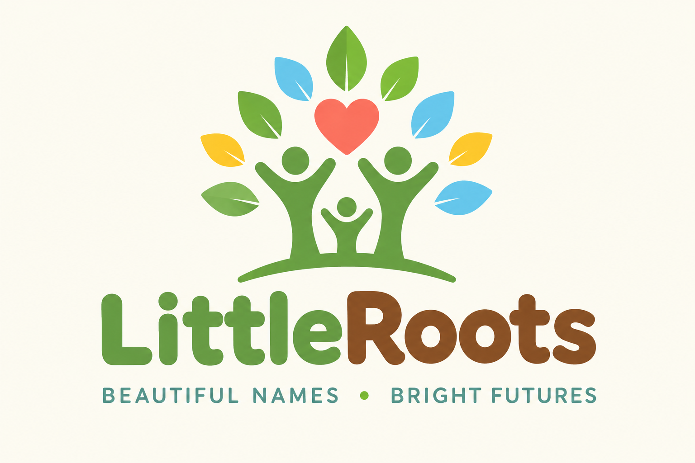
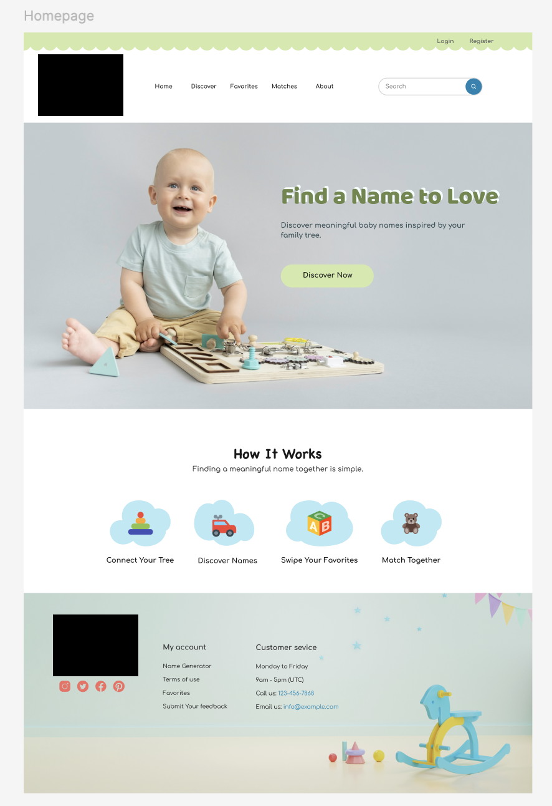

[](https://github.com/sims610/baby-name/actions/workflows/ci.yml)


# Overview
This project will be a FamilySearch based baby name generator web app. It will suggest baby names to you that are unique to your ancestry.

## Features
* Generate potential baby names from your family tree.
* Front-End similar to that of swiping on a dating app.
* Ability to link your account with a spouse to see the names you both matched on.
* Page of history and meaning for each name.
* Ability to filter suggestions by boy, girl, or surprise.

## Website Mock-up

### Logo




### Welcome Page



### Other Pages


## Getting Started

### Prerequisites
* [Node.js](https://nodejs.org/) (includes npm)

### Installation
From the project's root folder, install the dependencies:

```bash
npm install
```

This installs the dependencies for every workspace in one step, so you don't need to run it inside each folder.

### Running the App
Start the development servers:

```bash
npm run dev
```

This starts the API server on http://localhost:3000 and the client together. Once it's running, open the local URL Vite prints in the terminal (usually http://localhost:5173). The client forwards `/api` requests to the server, and http://localhost:3000/api/docs lists the available endpoints.

To try the app without registering, log in with the demo account **test@gmail.com** / **test1234**. It comes with saved favorites, a top 3, and a linked partner, **test2@gmail.com** (same password), so Matches has names to compare.

> **Note:** The server keeps accounts and favorites in memory, so restarting it erases them and signs everyone out. Names currently come from sample family tree data rather than FamilySearch.
